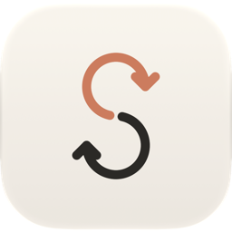

<p align="center">
  
</p>

<h1 align="center">CCSwift</h1>

<p align="center">
  One macOS menu-bar app to switch Claude accounts, separately for Claude Desktop and for Claude Code (CLI),
  with every account's plan usage in one place.
</p>

CCSwift is a fork of [songkeys/cc-same](https://github.com/songkeys/cc-same). It keeps CC Same's
Desktop session sync and one-click Desktop switching unchanged, and adds the CLI account switching of
[realiti4/claude-swap](https://github.com/realiti4/claude-swap) as a GUI. Thanks to both projects.

## What it does

The 720×660 window has two tabs: **Desktop | CLI**, with usage in every account row.

- **Desktop**: local Code sessions stay identical across accounts; switching restarts Claude
  Desktop signed in to the other account. Session sync has a manual action and an opt-in
  background switch. **Backups** lists local snapshots with their size and source, offers
  **Back up now**, restore confirmation (quit Claude first), Reveal in Finder, and retention
  of 10, 20, or 50 snapshots. Automatic snapshots happen during sync at the configured interval
  (one hour by default), and before restore; the baseline is always kept.
- **CLI**: the accounts in claude-swap's store (`~/.claude-swap-backup`), in slot order. Click
  **Switch** (or use the tray's *CLI* submenu) to change the account the `claude` command uses,
  using the same store as `cswap`. Claude Desktop is not touched. **+ Add** opens a dialog
  that detects the terminal login after `claude auth login`. Save a new account or choose
  **Update login** for an existing slot. **Sign in again** opens the same flow for a specific
  slot and refuses a different email or organization. `cswap` does not need to be installed.
  Each slot shows Valid, Renews on switch, Expired, or Unknown from its stored credential
  and latest usage request; the app never refreshes tokens.
- **Usage in each row**: 5-hour and weekly block bars, with orange at 80% and above. Desktop
  rows prefer successful CLI readings for the same email, otherwise Claude Desktop’s local
  history. CLI readings include reset times from the OAuth usage endpoint and are cached for
  a minute; add, update, or switch clears the cache. Refresh never writes credentials.
  Search appears above four accounts; sorting puts the highest 5-hour usage first.
  Unknown plan names and reset times display “—”; CLI rows show their real slot number.

Desktop and CLI are switched independently. The white and black themes use warm greys and
Claude orange, with Times New Roman for English and Songti SC for Simplified Chinese. Other
languages fall back to English. The optional Claude mark is read from the installed Claude.app
at runtime. Usage fetches start after the first frame; Keychain and network work runs off the
UI thread.

## Install (macOS, Apple Silicon)

Download `CCSwift-<version>-macos-arm64.dmg` from
[Releases](https://github.com/a1024053774/CCSwift/releases) and drag **CCSwift** to Applications.

- The build is **ad-hoc signed, not notarized**. If macOS blocks it, use
  **System Settings → Privacy & Security → Open Anyway** after checking the source.
- It shares CC Same's state folder (`~/Library/Application Support/cc-same`), so Desktop logins
  you saved in CC Same carry over. Run only one of CC Same and CCSwift at a time.
- It does not update itself. CLI accounts can be added in the app.
- Only tested on one Apple Silicon Mac. Windows and Linux builds of the fork are not provided.

## Build

```bash
cargo test --workspace
cargo test --manifest-path crates/app/Cargo.toml
scripts/bundle-macos.sh          # dist/CCSwift.app, .dmg, .zip
```

## Using the command line

```text
cc-same doctor         what every account has, and anything that needs attention
cc-same plan           what a sync would change (dry run)
cc-same sync           sync once
cc-same install        sync, then keep syncing in the background from login
cc-same uninstall      stop background syncing (every account keeps its full copy)
cc-same status         background sync and the last sync
cc-same snapshots      list snapshots
cc-same restore <id>   put every session list back as it was (quit Claude first)
cc-same retention      how long Claude Code keeps transcripts (--keep, --undo)
cc-same accounts       your accounts, numbered, with their plan usage (--json)
cc-same switch [<who>] switch Claude to an account, or the next one (--strategy best) (macOS)
cc-same add            restart Claude signed out, to add an account (the current one is kept)
cc-same remove <who>   take an account off the list, forgetting the sign-in kept for it
cc-same alias <who> <name>, disable <who>, enable <who>, move <who> <number>
cc-same config         --exclude <account-id>, --auto-join off, …
```

## What stays in sync

| | |
| --- | --- |
| Local Code sessions: title, archive state, model, permission mode, folder grants, linked PRs, worktrees | ✅ |
| Deletions (to a trash folder, recoverable) | ✅ |
| Code scheduled tasks and task suggestions | ✅ |
| Transcripts, `CLAUDE.md`, skills, `settings.json`, local MCP servers | Already shared by Claude |
| Connectors, Remote Control links, published artifacts, pins | Kept per account |
| Sidebar groups and order | ✗ Synced with each account's server settings, replaced at every sign-in |
| claude.ai chats, projects, memory, cloud sessions | ✗ Stored in each account in the cloud |
| Cowork tasks | ✗ On Pro and Max plans, new ones run in the cloud too |

## How it works

Claude Desktop writes only the index of the account it has open, and reads it only when that
account loads. CC Same never touches an index Claude has loaded. It mirrors that index to the
others, and catches up the one you left after you switch accounts or quit. For each session the
newest copy wins; deletions travel as Claude's own `deleted_<id>` markers.

Every index stays a real folder. The popular "merge the folders and symlink them" trick is
unsafe with current Claude Desktop, which silently stops saving sessions through a symlinked
folder. CC Same can undo that setup for you (`cc-same fix-symlinks`).

[docs/how-it-works.md](docs/how-it-works.md) has the details and the evidence.

## Safety

- A copy-on-write snapshot of every index is taken before the first change (kept forever) and at
  most hourly afterwards; `restore` puts any of them back.
- Session records removed or replaced by sync go to a trash folder for 30 days. Rolling
  snapshots are pruned to the configured retention limit; the baseline is kept.
- Writes are atomic, keep file times, never follow symlinks, and never overwrite a file that
  appeared or changed since planning.
- Fields that belong to one account (its connectors, Remote Control mirrors, published
  artifacts, pins) never travel to another.
- Session syncing needs no network access. CLI usage requests use each stored credential with
  Anthropic’s OAuth usage endpoint. This fork has no automatic updater.

## Building from source

```bash
cargo build --release                        # CLI (Rust 1.85+)
cargo test                                   # engine + CLI tests
cargo app                                    # run the app
cargo app-test                               # app tests
scripts/bundle-macos.sh                      # CC Same.app + archives in dist/
cargo app --example screenshot -- out/       # render every app state to PNG (macOS)
```

The app lives in `crates/app` as a workspace of its own, so the CLI never pulls in the GUI
framework; `cargo app`, `cargo app-build`, `cargo app-clippy` and `cargo app-test` are aliases for it.
Interface text is in [`crates/app/locales/app.yml`](crates/app/locales/app.yml), one entry per
message with a line per language.

Linux needs `clang cmake libfontconfig-dev libssl-dev libvulkan1 libwayland-dev libx11-xcb-dev
libxkbcommon-x11-dev libzstd-dev pkg-config` for the app.

### Releasing

Bump `version` in `Cargo.toml` and `crates/app/Cargo.toml` and add a `## <version> - <date>` section
to [CHANGELOG.md](CHANGELOG.md): it becomes the release notes, and the app shows it as *What's new*.
Pushing a `v*` tag builds every platform and attaches the files to a GitHub release. Mac builds are
signed with a Developer ID, notarized and stapled when the repository has these (otherwise they are
ad-hoc signed):

| Name | Kind | What |
| --- | --- | --- |
| `APPLE_CERTIFICATE_P12_BASE64` | secret | The Developer ID Application certificate and key, exported as `.p12`, base64 |
| `APPLE_CERTIFICATE_PASSWORD` | secret | The `.p12` password |
| `APPLE_API_KEY_P8_BASE64` | secret | An App Store Connect API key (`.p8`), base64 |
| `APPLE_API_KEY_ID` | variable | That key's ID |
| `APPLE_API_ISSUER` | variable | The issuer ID shown with the key in App Store Connect |
| `APPLE_SIGNING_IDENTITY` | variable | `Developer ID Application: <name> (<team>)` |

The same on your Mac: `CODESIGN_IDENTITY=… NOTARIZE=1 APPLE_API_KEY=… APPLE_API_KEY_ID=… APPLE_API_ISSUER=…
scripts/bundle-macos.sh`.

The app is built with Longbridge's [GPUI Kit](https://github.com/longbridge/gpui-kit) on
[GPUI](https://github.com/zed-industries/zed/tree/main/crates/gpui), Zed's GPU-accelerated UI
framework.

## License

[MIT](LICENSE). CC Same is an independent project, not affiliated with or endorsed by Anthropic.
Claude is a trademark of Anthropic.
